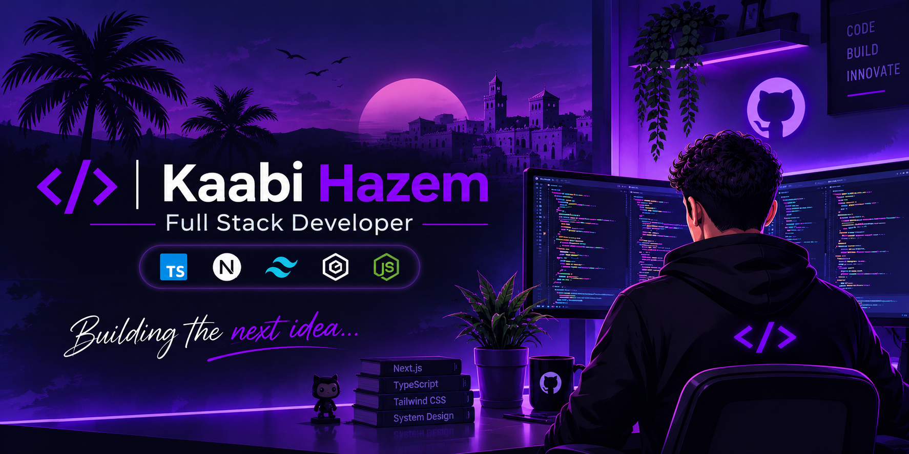

# Hello World!, I'm Hazem, a Full Stack Developer from Tunisia

### 💻 Tech Stack:

Lets hold it simple, there is much more but these tools are what I use daily: 

- Lang: Ts
- Framework: Next.js
- Styling: TailwindCSS & Shadcn

  

###

  
  
  
  
  
  
  
  
  
  
  
  
  
  
  
  
  
  
  
  
  
  
  
  
  
  
  
  
  
  
  

###

<picture>
<source media="(prefers-color-scheme: dark)" srcset="https://raw.githubusercontent.com/kaabihazem01/kaabihazem01/output/github-snake-dark.svg" />
<source media="(prefers-color-scheme: light)" srcset="https://raw.githubusercontent.com/kaabihazem01/kaabihazem01/output/github-snake.svg" />

</picture>

###
