<!--CARDS:START-->

  

  
  
  

  

  
  

  
  

  

<!--CARDS:END-->
<picture>
<source media="(prefers-color-scheme: dark)" srcset="https://raw.githubusercontent.com/kaabihazem01/kaabihazem01/output/github-snake-dark.svg" />
<source media="(prefers-color-scheme: light)" srcset="https://raw.githubusercontent.com/kaabihazem01/kaabihazem01/output/github-snake.svg" />

</picture>